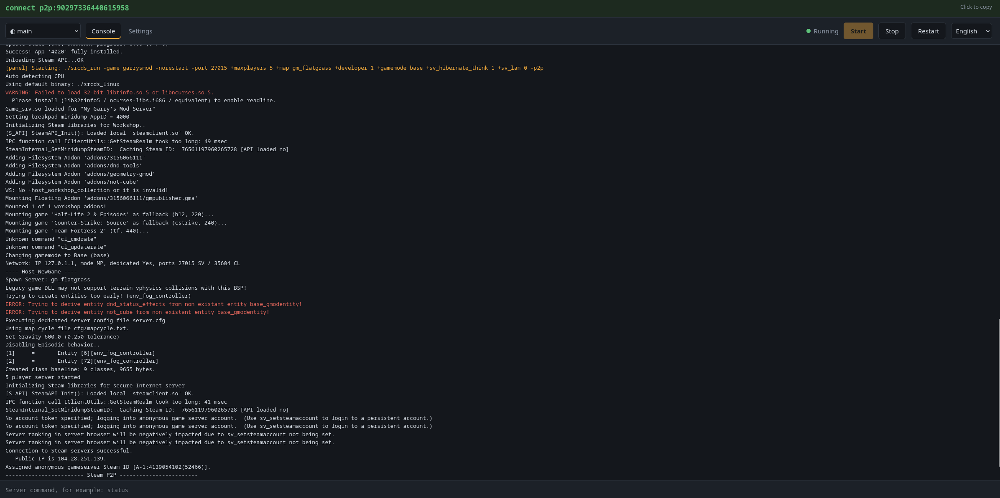

# 🎮 Garry's Mod Server Panel

<p align="center">
  <strong>A simple and lightweight web panel for managing your local Garry's Mod server.</strong>
</p>

<p align="center">
  
  
  
</p>

---

## 📖 Overview

**Garry's Mod Server Panel** is a lightweight web-based application designed to make managing your local Garry's Mod dedicated server easier.

The project provides a convenient interface for server management, with a focus on simplicity, accessibility, and ease of use.

Whether you're running a server for yourself or hosting a community, this project aims to make server administration more convenient.



## ✨ Features

- 🌐 **Web-Based Interface** - Manage your server through a web interface.
- 🖥️ **Local Server Management** - Designed for managing local Garry's Mod servers.
- 🌍 **Multilingual Support** - Available in English and Russian.
- ⚡ **Lightweight** - Built with Python and minimal dependencies.
- 🔓 **Open Source** - Released under the MIT License.

## 🌍 Languages

The interface supports the following languages:

- 🇬🇧 English
- 🇷🇺 Russian (Русский)

## 🚀 Getting Started

### Requirements

- Python 3.10 or newer with `venv` support. On Debian and Ubuntu, install `python3-venv` if needed.
- Access to a Python package index or a local directory of wheels for dependency installation and updates.

### ▶️ Running the Application

Clone the repository and open its directory in a terminal.

```bash
git clone https://github.com/GunterSuperPenguin/server-panel.git
cd server-panel
```

**Linux**

```bash
./run.sh
```

**Windows**

```bat
.\run.bat
```

The launcher creates `.venv` when needed and activates it. On each launch, it installs missing dependencies and upgrades installed dependencies when newer versions compatible with `pyproject.toml` are available. Open the address printed in the terminal, which defaults to `http://127.0.0.1:8080`.

Starting and controlling Garry's Mod dedicated servers requires Linux.

## 🛠️ Built With

- **Python** — Application logic.
- **Fluent Runtime** — Localization and translation support.
- **HTML / CSS / JavaScript** — Web interface.
